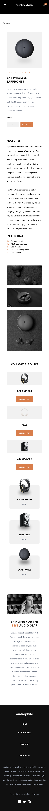
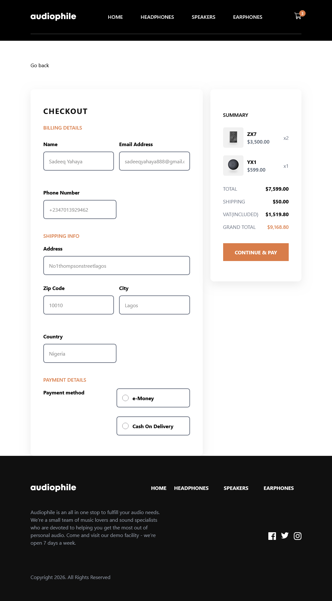
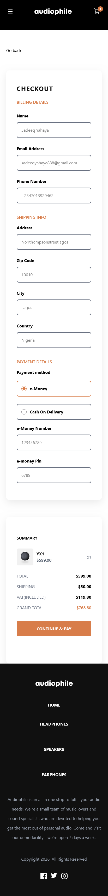
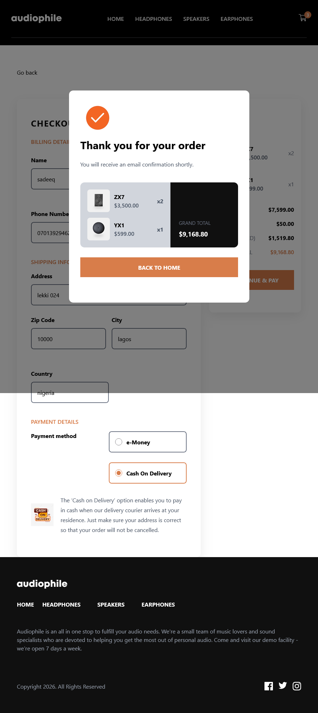

# Audiophile E-Commerce Website

This is an e-commerce website built with React, allowing users to explore premium headphones, speakers, and earphones, add products to their cart, and complete a checkout process.

## Table of contents

- [Overview](#overview)
  - [The project](#the-project)
  - [Screenshot](#screenshot)
  - [Links](#links)
- [My process](#my-process)
  - [Built with](#built-with)
  - [What I learned](#what-i-learned)
  - [Continued development](#continued-development)
  - [Useful resources](#useful-resources)
- [Author](#author)

## Overview

### The project

Users should be able to:

- View the optimal layout for each page depending on their device's screen size.
- Navigate between the homepage, product categories, and individual product pages.
- Browse headphones, speakers, and earphones.
- Add products to the cart and adjust product quantities.
- Remove individual products or clear the entire cart.
- Keep cart items saved when refreshing the page.
- View an order summary with calculated subtotal, shipping, VAT, and grand total.
- Complete the checkout form and see an order confirmation.
- Experience hover states and interactive elements throughout the website.

### Screenshot







### Links

- Solution URL: (https://github.com/Dev-sadeeq/audiophile-ecommerce)
- Live Site URL: (https://audiophile-ecommercemine.vercel.app/)

## My process

### Built with

- Semantic HTML5 markup
- React (Component-based architecture and reusable components)
- React Router DOM (Client-side routing and dynamic product pages)
- Tailwind CSS (Utility-first styling and responsive layouts)
- JavaScript (ES6+)
- React Context API (Global cart state management)
- React Hooks (`useState`, `useEffect`, and `useContext`)
- localStorage (Cart data persistence)
- Mobile-first workflow

### What I learned

Working on this project helped me strengthen my understanding of React, particularly component reusability, state management, routing, and handling data across different parts of an application.

Key technical highlights include:

- **Reusable Components:** Building reusable components such as the Hero, CategoryCard, BrandSection, and CategoryPage to reduce code duplication and keep the application organized.
- **Dynamic Routing:** Using React Router and URL parameters to display individual product details based on their slugs.
- **Global State Management:** Using the Context API to manage cart data and make cart functions accessible across components without unnecessary prop drilling.
- **Cart Functionality:** Implementing product quantity management, adding and removing products, calculating cart totals, and persisting cart data with localStorage.
- **Checkout Calculations:** Calculating subtotal, shipping fees, VAT, and the final order total dynamically.
- **Responsive Design:** Using Tailwind CSS responsive utilities to create layouts that adapt to mobile, tablet, and desktop screens.
- **Form Handling:** Building a checkout form with different payment methods and an order confirmation modal.

One important concept I learned was how to use the Context API to share cart state across components.

For example, the cart count is calculated from the quantities of all products in the cart:

```jsx
const cartCount = cart.reduce(
  (acc, currentItem) => acc + currentItem.quantity,
  0
);
```

This ensures that the cart badge reflects the total number of items rather than just the number of different products.

### Continued development

In future projects, I want to continue improving my React skills, particularly in form validation, advanced state management, and writing cleaner, more maintainable code.

I also plan to explore better ways to handle errors, improve accessibility, and build more complex interactive applications.

### Useful resources

- [React Documentation](https://react.dev/) - Helped me understand React components, props, state, and hooks.
- [React Router Documentation](https://reactrouter.com/) - Useful for implementing navigation and dynamic routes.
- [Tailwind CSS Documentation](https://tailwindcss.com/docs) - Helped with responsive layouts, styling, and utility classes.
- [MDN Web Docs](https://developer.mozilla.org/) - Useful for understanding JavaScript methods, HTML elements, and browser APIs.

## Author

- Frontend Mentor - [@Dev-sadeeq](https://www.frontendmentor.io/profile/Dev-sadeeq)
- Twitter - [@Dev_sadeeqq](https://www.twitter.com/Dev_sadeeqq)